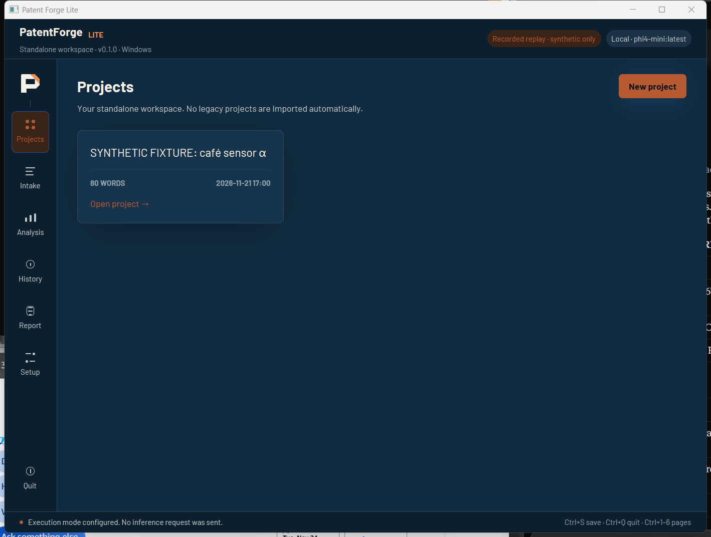

# PatentForge Lite

**A standalone, native patent research and drafting workspace.** Point it at an invention,
and it walks four analyses in order — feasibility, claims, compliance and a full application
draft — keeping every stage, every prompt and every report on your own machine.

Rust core · GPUI desktop · Windows, macOS and Linux · no browser, no account, no legacy services.

---

## What it does

PatentForge Lite runs **four analyses**, each building on the last:

| Analysis | Stages | What you get |
| --- | --- | --- |
| **Feasibility** | 6 | Technical restatement, prior-art landscape, patentability (§102/§103/§112), deep dive, IP strategy, consolidated report |
| **Claims drafting** | 4 | A claim strategy, up to 20 claims (broad/medium/narrow independents plus dependents), an examiner pass, and a revision |
| **Compliance review** | 4 | Written description, definiteness, formalities and eligibility findings |
| **Application drafting** | 5 | Abstract, background, summary, detailed description, drawings list — assembled with claim set and an information-disclosure statement |

Dependent analyses refuse to start until the ones they consume have finished, and each run
snapshots the exact upstream text it read. Re-running feasibility later never changes a claims
run you already have.

Everything ends in a saved report you can export as **Markdown, HTML or Word (.docx)**.

## What it looks like



The interface follows the PatentForge identity: ink surfaces, paper documents, copper actions,
Barlow type. Reports open as a document — not raw markdown.

## Requirements

- **Windows 10/11 x64**, **macOS 13+ (arm64)** or **Linux x64** with a working GPU for the desktop.
- **An inference runtime or recorded fixtures:**
  - *Recorded replay* — bundled synthetic outputs. No model, no network, instant. Best for
    learning the interface and for verifying behaviour deterministically.
  - *Local* — an existing [Ollama](https://ollama.com) installation. You choose the endpoint and
    model; Lite never downloads or starts one for you.
  - *Cloud* — an Anthropic API key, only if you explicitly authorize a paid call per run.

## Install

**Windows** — download `patent-forge-lite-<version>-x64.exe` from
[Releases](https://github.com/scottconverse/patent-forge-lite/releases), run it, done. Per-user
install, no administrator rights. Uninstalling does **not** delete your projects.

The Windows installer is Authenticode-signed with Azure Trusted Signing (publisher **Scott
Converse**). The pipeline fails closed if the signature does not verify, and the installer embeds
the signed application binary.

**macOS / Linux** — download the archive for your platform from Releases and see
[the user manual](docs/USER-MANUAL.md#macos-and-linux) for the two commands it takes. These
builds are **unsigned**, so macOS Gatekeeper needs a right-click → Open the first time.

```bash
# macOS (arm64)
unzip patent-forge-lite-<version>-macos-arm64.zip
open "Patent Forge Lite.app"

# Linux (x86_64)
tar xzf patent-forge-lite-<version>-linux-x64.tar.gz
./patent-forge-lite/pfl-desktop
```

## First five minutes

1. Launch. You land on **Projects**.
2. **New project** → fill in the title and a description of at least 50 words (the counter turns
   green when you meet it) → **Save intake**.
3. Open **Execution setup** → *Use synthetic recorded replay* → tick *This invention is synthetic
   test data*.
4. Back to **Analysis** → pick a workflow → **Start new version**. In replay this is instant.
5. Open **Report** → read it → **Export Word**.

That whole path works offline with no model. When you want real analysis, point it at your local
Ollama in Execution setup and choose **Full** setup profile.

The complete walkthrough — every screen, every control, every troubleshooting step — is the
**[user manual](docs/USER-MANUAL.md)**.

## Keyboard

| Keys | Action |
| --- | --- |
| `Ctrl+1` … `Ctrl+6` | Projects · Intake · Analysis · History · Report · Setup |
| `Ctrl+S` | Save intake |
| `Ctrl+Q` | Quit (warns about unsaved edits and running analyses) |
| `Tab` / `Shift+Tab` | Move between fields and controls (every control shows a focus ring) |

## Where your data lives

One SQLite file per user, never shared with the old PatentForge:

- Windows: `%LOCALAPPDATA%\patent-forge-lite\projects.sqlite3`
- macOS: `~/Library/Application Support/patent-forge-lite/projects.sqlite3`
- Linux: `${XDG_DATA_HOME:-~/.local/share}/patent-forge-lite/projects.sqlite3`

A sibling `.lock` file guarantees a single owner: two copies cannot run against one profile.
Back up by copying that directory. See [coexistence](#coexistence-with-patentforge).

## Coexistence with PatentForge

Lite is a **separate application with its own identity, data directory and lock**. It never opens,
modifies or migrates an existing PatentForge installation, and shipping it does not retire anything.
Real-data migration is a later, opt-in, copy-first operation.

## Development

```bash
cargo test --workspace            # 104 tests
cargo clippy --workspace --all-targets -- -D warnings
cargo build -p pfl-desktop --features native
cargo run   -p pfl-cli -- pipeline --workspace ./synthetic
```

Crates: `pfl-domain` (contracts), `pfl-storage` (SQLite), `pfl-workflow` (four workflows, providers,
research seam), `pfl-api` (compatibility HTTP surface), `pfl-desktop` (GPUI), `pfl-cli` (harness:
`replay`, `import-replay`, `pause-fixture`, `resume`, `pipeline`, `serve`, `live`, `inspect`).

Toolchain is pinned to Rust 1.98.1 and GPUI to a single Zed revision; both are recorded in
`Cargo.toml` and `docs/BUILD-EVIDENCE.md`. CI compiles, tests and lints on Windows x64, macOS arm64
and Linux x86_64.

### Automation and testing

`scripts/ui-acceptance.ps1` drives the real native window through Windows UI Automation — 26 checks
covering navigation, field disclosure, execution mode, a recorded run to completion, history,
report rendering and shortcuts. `scripts/preflight.ps1` verifies a build before you trust it.

## Honest status

| Area | State |
| --- | --- |
| Core, four workflows, storage, exports, CLI, API | Implemented and tested |
| Windows desktop | Built, launched, driven by hand and by automation |
| macOS / Linux desktop | **Compile + test green in CI**; no installed or interactive acceptance yet |
| Windows installer | Built, installed, uninstalled and verified — **signed with Azure Trusted Signing** |
| macOS / Linux packages | Built and published **unsigned** |
| Live local inference | Verified on one model (`phi4-mini`), all four workflows |
| Live Cloud inference | Fail-closed; verified against a mock only |
| Live prior-art research | Seam and fixture source only — no external provider |

The full inventory is [docs/STATUS.md](docs/STATUS.md); every check and its evidence is
[docs/BUILD-EVIDENCE.md](docs/BUILD-EVIDENCE.md).

## Legal

Patent analysis output from this tool is **research assistance, not legal advice**, and the
generated drafts are **not for filing**. Models can invent prior-art references; verify everything
before relying on it, and have a registered patent attorney review any filing.

Licensing: see [LICENSE](LICENSE) for the source, [LICENSE-PROMPTS](LICENSE-PROMPTS) for the
prompt text (upstream prompts are CC-BY-SA 4.0), and [THIRD_PARTY_NOTICES.md](THIRD_PARTY_NOTICES.md)
for Barlow (SIL OFL) and the GPUI dependency. Product disclaimers are reproduced in
[LEGAL_NOTICE.md](LEGAL_NOTICE.md).

## Documents

- **[User manual](docs/USER-MANUAL.md)** — how to actually use it
- [Product status](docs/STATUS.md) · [Build evidence](docs/BUILD-EVIDENCE.md)
- [Architecture](docs/ARCHITECTURE.md) · [Workflow execution](docs/workflow.md) ·
  [Storage and migration](docs/storage-and-migration.md)
- [Compatibility API](docs/API.md) · [Native desktop notes](docs/native-ui.md)
- [Packaging](docs/PACKAGING.md) · [Interactive checklist](docs/INTERACTIVE-CHECKLIST.md) ·
  [First-slice acceptance](docs/FIRST-SLICE-ACCEPTANCE.md)
